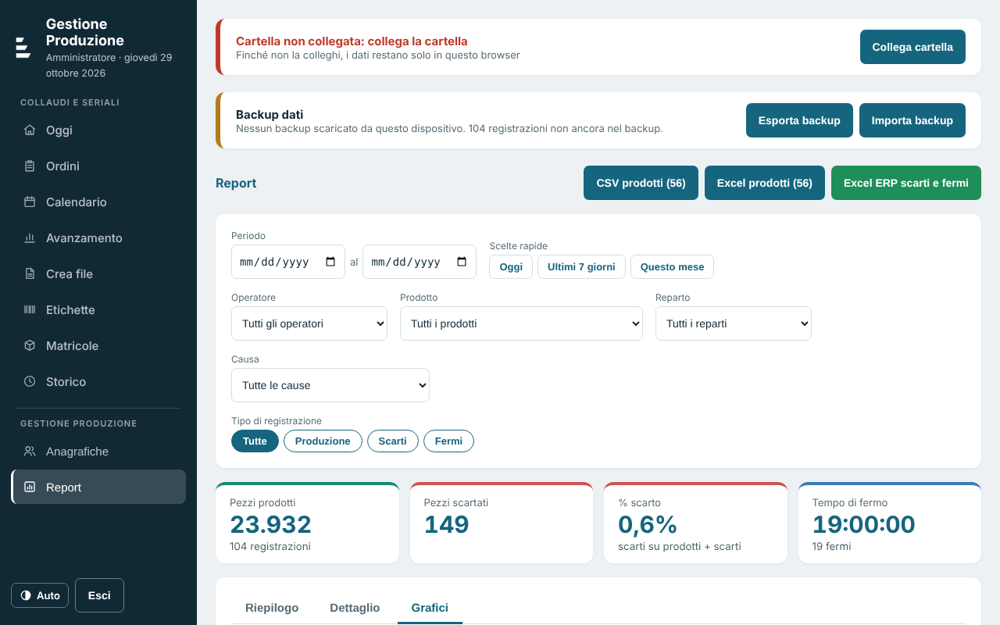
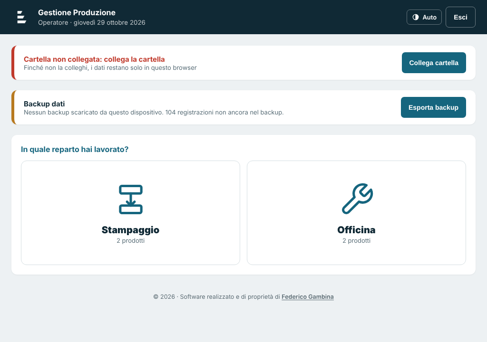
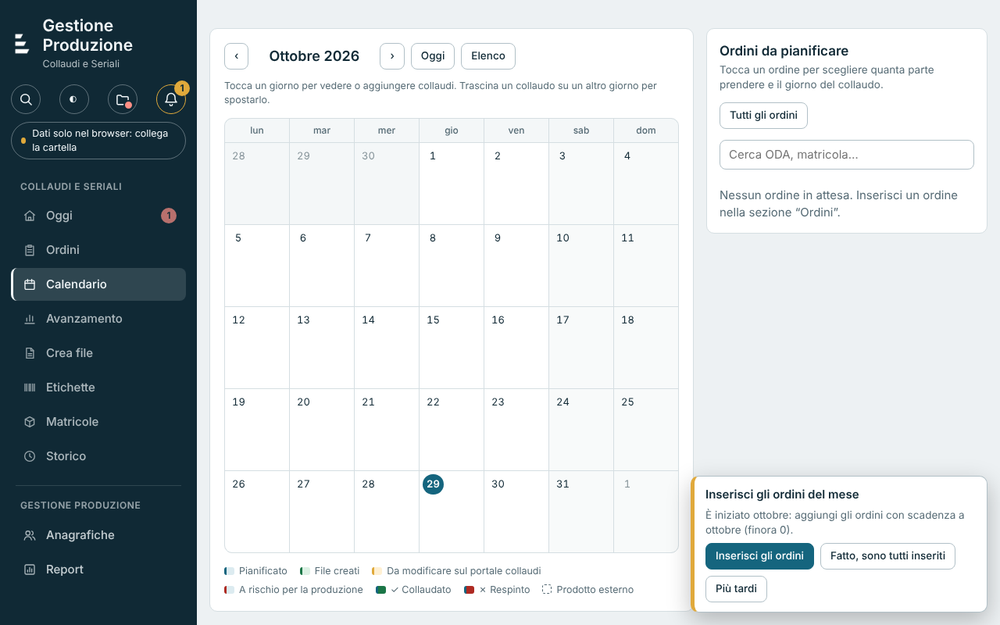
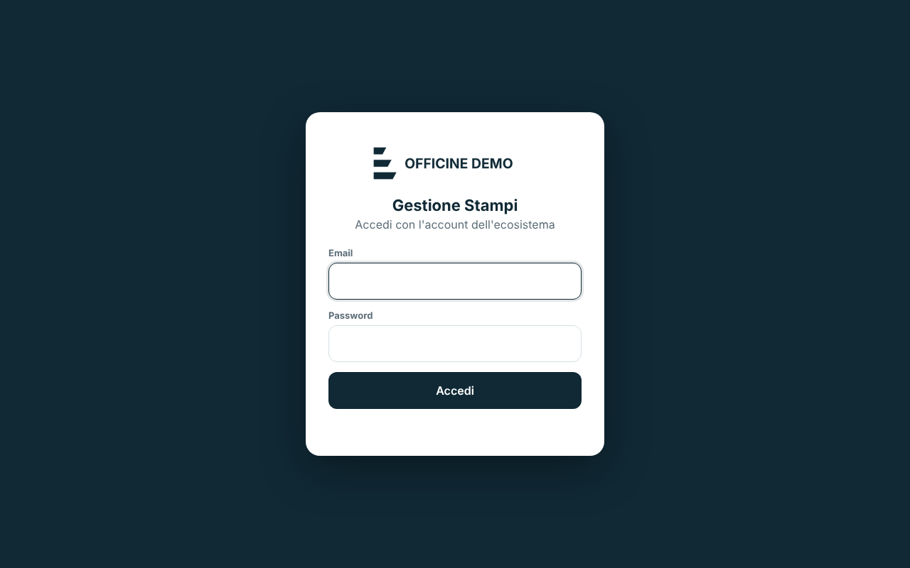
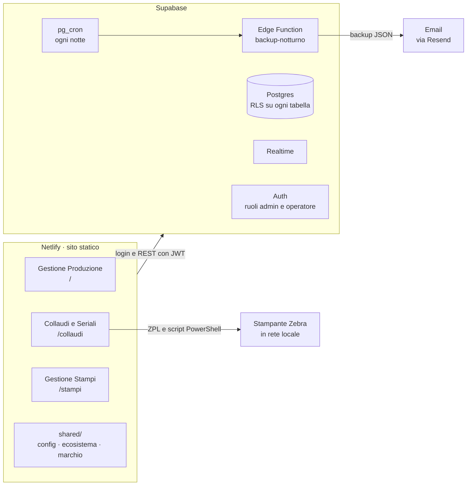

# Ecosistema processi aziendali

Tre web app che digitalizzano i processi ripetitivi di un'azienda manifatturiera di componenti per la rete elettrica: la **registrazione della produzione** a fine turno, la **pianificazione dei collaudi con la generazione dei numeri di serie** e la **gestione degli stampi** del reparto stampaggio.

Sono nate per sostituire fogli Excel e passaggi manuali, partendo da una versione che girava in locale su una cartella condivisa e arrivando a un ecosistema online con un unico database, un'unica autenticazione e i dati aggiornati in tempo reale tra PC d'ufficio e tablet in reparto.

> Questa è una **versione dimostrativa e anonimizzata** del software in uso in azienda. Marchio, clienti, codici prodotto, regole di numerazione e destinazioni sono stati sostituiti con valori di esempio; nel repository non ci sono chiavi né dati reali.



## I moduli

| App | Percorso | Chi la usa | Cosa fa |
|---|---|---|---|
| **Gestione Produzione** | `/` | Operatori su tablet, amministratore | A fine turno l'operatore sceglie reparto, nome e prodotto e inserisce pezzi, scarti con causa e fermi con durata, con un tastierino a schermo. L'amministratore gestisce le anagrafiche e consulta report con filtri, grafici ed export CSV/Excel per l'ERP. |
| **Collaudi e Seriali** | `/collaudi/` | Ufficio tecnico e logistica | Legge gli ordini d'acquisto dai PDF dei clienti, li divide in lotti per destinazione, pianifica i collaudi sul calendario in base al ritmo medio dell'officina, assegna matricole e pallet e genera Excel di produzione, CSV per il portale del cliente ed etichette per stampanti Zebra (ZPL). |
| **Gestione Stampi** | `/stampi/` | Reparto stampaggio, tablet | Anagrafica degli stampi con QR/barcode, posizione in magazzino (zona, scaffale, ripiano) e stato: in magazzino, alla pressa, in manutenzione, presso un coproprietario o un partner. Ogni cambio di stato lascia un movimento nello storico. |

Le due app principali condividono un modulo di calcolo ([`shared/js/ecosistema.js`](web/shared/js/ecosistema.js)): gli ordini del portale collaudi diventano previsioni per la produzione e i pezzi registrati in reparto aggiornano l'avanzamento dei collaudi, con promemoria quando un lotto rischia di non essere pronto.

| Operatore su tablet | Calendario dei collaudi | Accesso a Gestione Stampi |
|---|---|---|
|  |  |  |

## Architettura



- **Nessun framework e nessuna build**: HTML, CSS e JavaScript nativi, pensati per girare anche su tablet economici. Gli script sono classici (non moduli ES) e si caricano in ordine, così Produzione e Collaudi funzionano anche aprendo `index.html` dal disco; la lettura dei PDF richiede invece un server, anche solo `npm run dev`.
- **Due modalità di archivio**: senza configurazione Produzione e Collaudi salvano i dati in una cartella collegata (File System Access API) o nel browser, con esportazione e importazione di backup JSON; con Supabase configurato diventano web app condivise.
- **Sicurezza nel database**: ogni tabella ha Row Level Security e le policy leggono il ruolo dal JWT (`app_metadata.ruolo`). Gli operatori possono inserire registrazioni ma non leggerle o cancellarle, salvo correggere le proprie entro 15 minuti; le operazioni sensibili passano da funzioni `security definer`.
- **Tracciabilità**: un trigger generico scrive in `registro_modifiche` solo i campi cambiati, con utente e ora.
- **Backup**: ogni notte `pg_cron` chiama una Edge Function che esporta portale, produzione e stampi in JSON e li invia per email con Resend. Il token del compito e la chiave Resend restano nel Vault di Supabase.
- **Lettura degli ordini PDF** con [pdf.js](web/vendor/pdfjs/) caricato solo al primo PDF, e **PDF ed Excel generati nel browser** senza librerie esterne (scrittura diretta di PDF e OOXML).

## Struttura

```
web/                         sito pubblicato (cartella publish di Netlify)
├─ index.html                Gestione Produzione
├─ produzione/  css/ js/     stili e logica di Produzione
├─ collaudi/                 Collaudi e Seriali
│  ├─ css/
│  └─ js/                    archivio online e locale, seriali, modello Excel, app
├─ stampi/                   Gestione Stampi (PWA installabile con service worker)
├─ shared/
│  ├─ js/                    config.example.js, ecosistema.js, footer.js
│  └─ brand/                 logo, simbolo e icone (marchio di esempio)
└─ vendor/pdfjs/             pdf.js compresso
supabase/
├─ migrations/               schema completo, in ordine di rilascio
├─ functions/backup-notturno Edge Function del backup
└─ seed.sql                  anagrafiche di esempio
demo/produzione-demo.json    dati inventati da importare in Gestione Produzione
scripts/genera-config.mjs    crea web/shared/js/config.js dalle variabili d'ambiente
```

## Provarlo in locale

Serve solo Node.js 18 o più recente.

```bash
npm run dev        # crea una configurazione vuota e apre il sito su http://localhost:8080
```

Senza Supabase Produzione e Collaudi lavorano nel browser:

1. Apri `http://localhost:8080`, accedi come amministratore con `admin` / `1234` (operatore: `user` / `1234`; credenziali valide solo in modalità locale).
2. In **Backup dati › Importa backup** scegli `demo/produzione-demo.json`: trovi operatori, prodotti, cause e due settimane di registrazioni inventate.
3. Apri **Report** per filtri, riepiloghi e grafici, oppure **Collaudi e Seriali** dal menu.

Gestione Stampi richiede sempre Supabase.

## Collegarlo a Supabase

1. Crea un progetto Supabase e applica le migrazioni di `supabase/migrations` (con la Supabase CLI: `supabase db push`). Nella migrazione del backup sostituisci `<PROJECT_REF>` con il riferimento del progetto.
2. Facoltativo: carica `supabase/seed.sql` per avere anagrafiche di esempio.
3. Crea gli utenti da **Authentication** e assegna il ruolo in `app_metadata` (`{"ruolo": "admin"}` oppure `{"ruolo": "operatore"}`), come mostrato in `seed.sql`.
4. Pubblica la Edge Function: `supabase functions deploy backup-notturno --no-verify-jwt`. La chiave Resend si inserisce dal portale Collaudi, in Storico › Backup notturno, e finisce nel Vault.
5. Configura il sito: copia `.env.example` in `.env`, inserisci URL e chiave **publishable** ed esegui `npm run config`. Su Netlify imposta `SUPABASE_URL` e `SUPABASE_KEY` tra le variabili d'ambiente: il comando di build genera `config.js` a ogni deploy.

La chiave publishable è fatta per stare nel browser: i dati sono protetti dalle policy RLS. Lo script di configurazione rifiuta le chiavi `service_role` e `sb_secret_`.

## Prossimi passi

- Dividere `collaudi/js/app.js` (circa 3.900 righe in un'unica funzione) in moduli ES, con un bundler come Vite.
- Unificare le variabili di colore delle tre app in un unico file di token CSS, oggi definite in ciascun foglio di stile.
- Portare in locale le librerie caricate da CDN in Gestione Stampi (supabase-js e qrcodejs).
- Collegare le presse del reparto stampaggio, già in rete con un indirizzo IP, per leggere i pezzi prodotti senza inserimento manuale.

## Autore

Progettato e sviluppato da [Federico Gambina](https://www.linkedin.com/in/federicogambina/) con il supporto di strumenti di AI generativa (Claude).

## Licenza

Tutti i diritti riservati: il codice è pubblicato a scopo di portfolio. Vedi [LICENSE](LICENSE).
